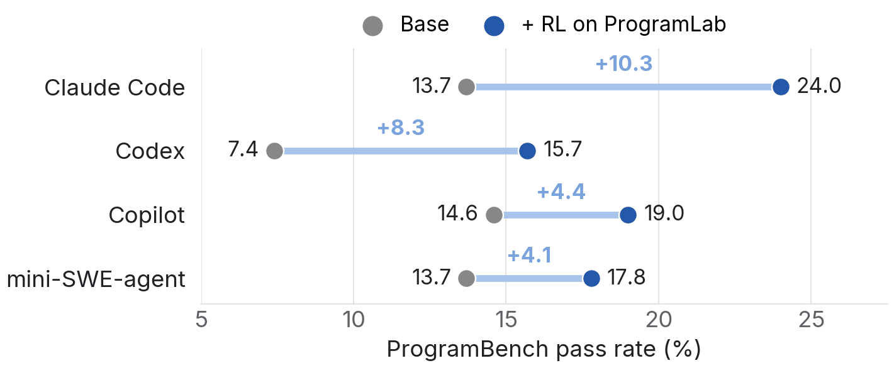

<p align="center">
  
</p>

<p align="center"><b>Train single and multi agents to rebuild programs with RL</b></p>

<p align="center">
  <a href="https://programlab.blog/"></a>
  <a href="https://huggingface.co/datasets/Program-Lab/ProgramLab"></a>
  <a href="LICENSE"></a>
</p>

## Contents

- [News](#news)
- [What's inside](#whats-inside)
- [Results](#results)
- [Quickstart](#quickstart)
  - [Try a task](#try-a-task)
  - [Evaluate a run](#evaluate-a-run)
  - [Pick tasks for training](#pick-tasks-for-training)
  - [Rebuild the images](#rebuild-the-images)
- [Citation](#citation)
- [License](#license)
- [Acknowledgements](#acknowledgements)

## News

- **2026-10**: ProgramLab is out, with 1,261 environments, their hidden tests, and prebuilt cleanroom images. Read the [blog](https://programlab.blog/).
- ⏳ **Nov. 10–17**: We will release RL-Bridge.

## What's inside

| Tasks | Languages | Difficulty | Hidden tests | Code coverage |
|:---:|:---:|:---:|:---:|:---:|
| **1,261** | 566 Go · 415 Rust · 280 C/C++ | 205 easy · 888 medium · 168 hard | **187,073** (median 127 per task) | median **76.6%** |

In each task the agent can run the reference program but not read it, and it can read the program's documentation. It writes the program again in any language, plus a `compile.sh` that builds it. Hidden tests then compare its program with the reference. Three examples:

| Task | What it does | Size | Hidden tests |
|---|---|---|---|
| [mkcert](https://github.com/FiloSottile/mkcert) | Makes locally trusted HTTPS certificates | Easy · Go · ~1.4K lines | 121 |
| [jless](https://github.com/PaulJuliusMartinez/jless) | Command-line viewer for exploring JSON | Medium · Rust · ~11K lines | 106 |
| [caddy](https://github.com/caddyserver/caddy) | Web server with automatic HTTPS | Hard · Go · ~99K lines | 262 |

## Results

With Qwen3.6-35B-A3B, RL on ProgramLab raises the ProgramBench pass rate:

- **Single agent**: 13.7% → 24.0% in Claude Code, with a two-hour budget.
- **Five-agent team**: 17.2% → 25.0% in [Agensh](https://agens-harness.github.io/project/), with a 30-minute budget.

<p align="center"></p>

## Quickstart

### Try a task

Every task is a public image. This drops you into the cleanroom of `mkcert`, offline:

```bash
docker run -it --rm --network none --user 1000:1000 ghcr.io/programlab-agent/programlab:filosottile__mkcert.2a46726
```

Inside, `/workspace/executable` is the reference program (execute-only) and `/workspace` holds its documentation.

### Evaluate a run

```bash
pip install programbench==1.2.4
git clone https://github.com/programlab-agent/ProgramLab
bash ProgramLab/setup.sh            # all tasks; or a regex, e.g. 'mkcert|jless'
export PROGRAMBENCH_DOCKER_ORG=ghcr.io/programlab-agent
export PROGRAMBENCH_HF_REPO=Program-Lab/ProgramLab-Tests
programbench eval my-run
```

`setup.sh` installs the task definitions into ProgramBench and pulls the images you selected. A run directory holds one `submission.tar.gz` per task:

```
my-run/
├── filosottile__mkcert.2a46726/submission.tar.gz
└── pauljuliusmartinez__jless.21dd610/submission.tar.gz
```

`PROGRAMBENCH_DOCKER_ORG` is global, so a shell set up for ProgramLab does not also score upstream ProgramBench tasks.

### Pick tasks for training

[`instances.jsonl`](https://huggingface.co/datasets/Program-Lab/ProgramLab/blob/main/instances.jsonl) has one row per task with its language, difficulty, size, test count, coverage, license, and image:

```python
import json
tasks = [json.loads(line) for line in open("instances.jsonl")]
easy_rust = [t["instance_id"] for t in tasks if t["difficulty"] == "easy" and t["language"] == "rs"]
```

### Rebuild the images

The Docker build context of every task and the base image are in `build/` of the dataset, if you would rather not pull from GHCR.

## Citation

```bibtex
@misc{programlab2026,
  title={ProgramLab: Train single and multi agents to rebuild programs with RL},
  author={Yao Tang and Daixuan Cheng and Li Dong and Zhihao Zhan and Shaohan Huang and Jiatao Gu and Furu Wei},
  howpublished={Blog Post},
  url={https://programlab.blog/},
  year={2026}
}
```

## License

The code in this repository is released under the [MIT License](LICENSE). Each task ships a program from a public repository under that program's own license, given in the `license` field of `instances.jsonl`.

## Acknowledgements

ProgramLab is built upon [ProgramBench](https://github.com/facebookresearch/ProgramBench). We thank the authors for the great work.
